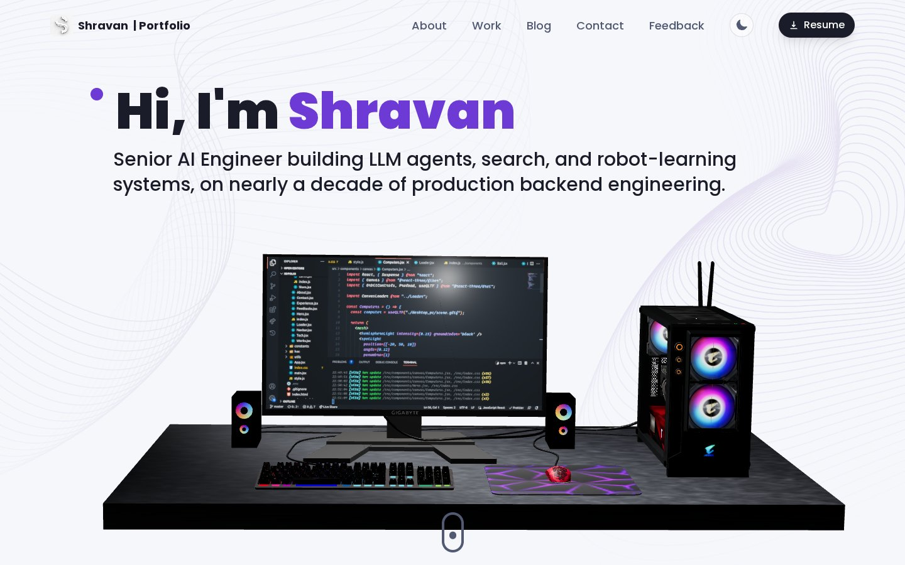
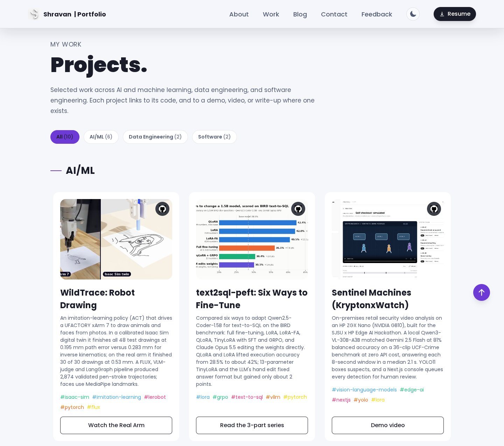
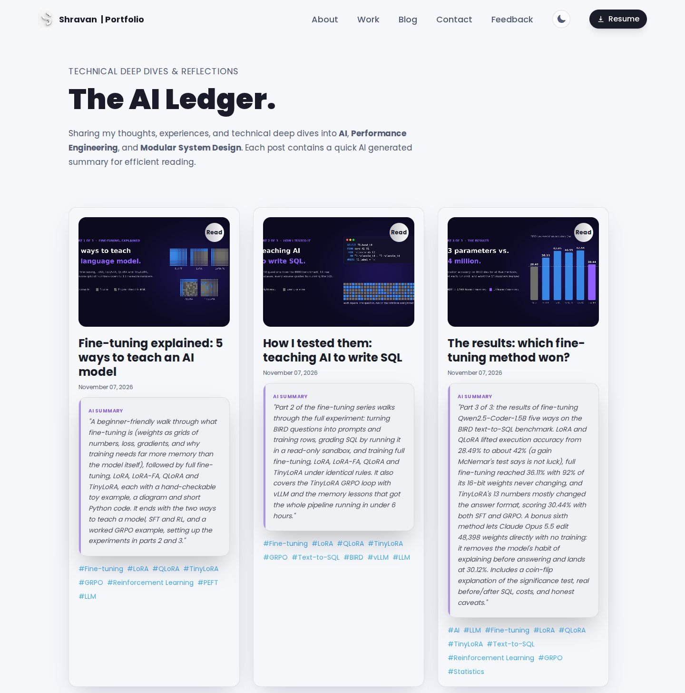

# Portfolio Website

A modern, full-stack portfolio showcasing technical expertise through interactive 3D experiences and robust backend architecture.

[](https://shra012.github.io/Portfolio)

## Screenshots

**Projects**: grouped into AI/ML, Data Engineering and Software tabs, each card linking to code and a demo, video or write-up.



**Blog ([The AI Ledger](https://shra012.github.io/Portfolio/#/blog))**: technical deep dives, each with a short AI summary.



## Why This Project

**Problem Solved**: Traditional portfolios fail to demonstrate real-world engineering skills. This project bridges that gap by implementing production-grade solutions while creating an engaging user experience.

**Business Value**: Demonstrates ability to architect scalable systems, optimize performance across browsers, and deliver polished user experiences - skills directly transferable to enterprise development.

## Technical Highlights

### Full-Stack Architecture
- **Frontend**: React 18 + Three.js with WebGL optimization for Chrome/Firefox compatibility
- **Backend**: Serverless functions (Digital Ocean) for scalable contact handling
- **DevOps**: Automated CI/CD pipeline with GitHub Actions for seamless deployments

### Engineering Excellence
- **Performance**: Cross-browser WebGL optimization, lazy loading, and hardware acceleration
- **Reliability**: Error boundaries, graceful degradation, and comprehensive fallback systems
- **Security**: Environment-based secrets management and input validation
- **Scalability**: Serverless architecture with auto-scaling capabilities

### Real-World Implementation
- **Email System**: Nodemailer integration with confirmation workflows
- **3D Graphics**: Custom Three.js components with context loss recovery
- **Responsive Design**: Mobile-first approach with adaptive rendering
- **Monitoring**: Deployment status tracking and error handling

## Project Structure

```
├── frontend/          # React + Three.js application
├── backend/           # Express.js API and serverless functions
└── .github/          # CI/CD automation workflows
```

## Live Demo

🌐 **[View Portfolio](https://shra012.github.io/Portfolio)**

## Key Learnings

- **Cross-browser compatibility** challenges and solutions in WebGL in Chrome.
- **Serverless architecture** design patterns and deployment strategies
- **Performance optimization** for graphics-intensive web applications
- **DevOps automation** for streamlined development workflows

---

*This project demonstrates end-to-end software development skills, from UI/UX design to backend architecture and deployment automation - showcasing my software skills.*
